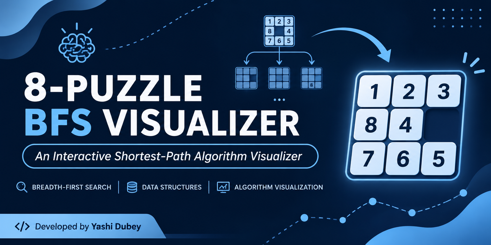
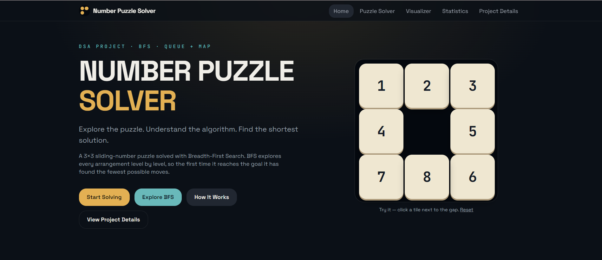
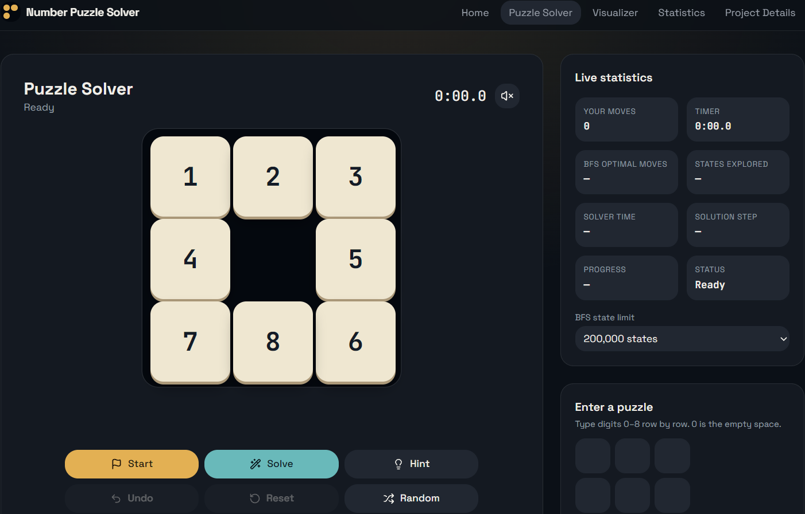
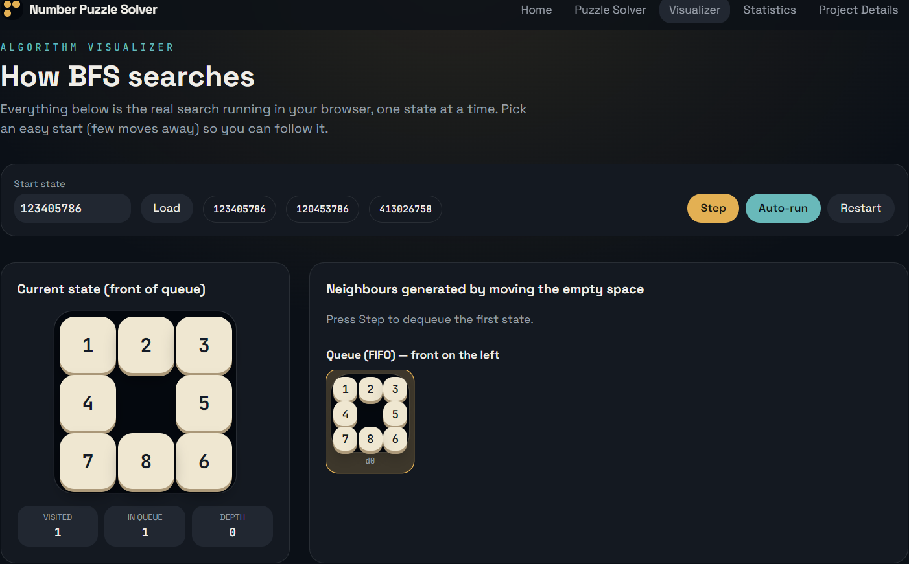
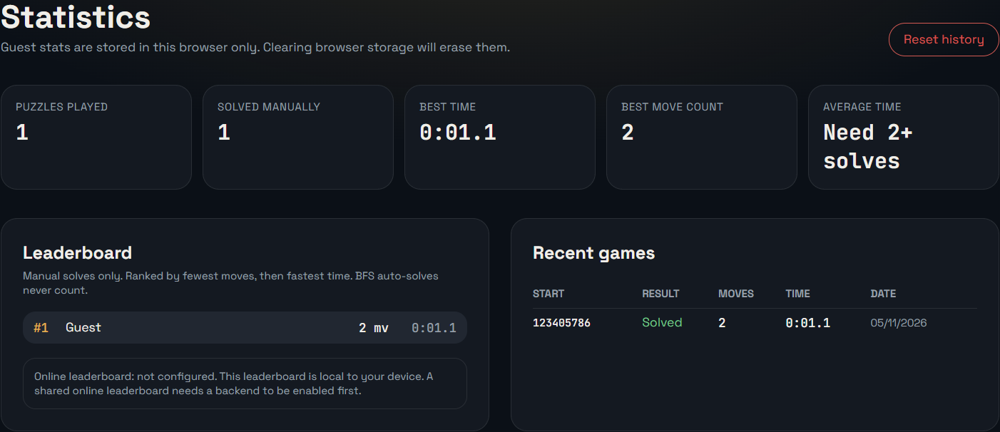

## Number Puzzle Solver – BFS Visualizer

An interactive 3×3 sliding puzzle application that uses **Breadth-First Search (BFS)** to find the shortest solution path and visualize how the algorithm explores different puzzle states.

🔗Live Demo:
https://puzzle-bfs-visualizer.lovable.app 

## About the Project

The Number Puzzle Solver is based on the classic 8-puzzle problem. The objective is to arrange eight numbered tiles in the correct order by moving them into an empty space.
The application allows users to solve puzzles manually or automatically while understanding the working of the BFS algorithm through a step-by-step visualizer.

## Key Features

- **Interactive Puzzle:** Play by clicking tiles or entering custom configurations.
  
- **Random Puzzle Generation:** Generate solvable puzzle configurations.
  
- **Automatic Solver:** Find the shortest solution using BFS.

- **Hint & Undo:** Get the next correct move or reverse previous moves.
  
- **Solution Playback:** Play, pause, restart, navigate and adjust playback speed.
  
- **BFS Visualizer:** Observe the queue, visited states, generated states and skipped repetitions.
  
- **Game Statistics:** Track games played, solved games, best time and move counts.
  
- **Input Validation:** Handle invalid, repeated, incomplete and unsolvable configurations.

## Algorithm & Data Structures

**Algorithm:** Breadth-First Search (BFS)

BFS explores puzzle configurations level by level using a queue. Each valid tile movement creates a new state. Previously visited states are skipped to avoid repeated exploration.

Since every move has equal cost, BFS guarantees the shortest solution path when the search completes.

## Data Structure 
Queue: Stores states waiting to be explored.

Map:Tracks visited states and helps reconstruct the solution.

Set:Prevents repeated state exploration, if used. 

Array:Represents the puzzle board.

## Performance & Testing

## Metric & Result
Automated Tests: 10 Passed

Hardest Puzzle Tested: `867254301`

Shortest Solution: 31 Moves

Observed Solving Time: ~0.3 Seconds

The application also handles unsolvable configurations and search-limit conditions with appropriate messages.

## Technologies Used

Frontend: Add actual framework and language.

Algorithm: Breadth-First Search.

Data Structures: Queue, Map, Set and Arrays.

Tools: Git, GitHub and Lovable.

## Application Sections
## 📸 Screenshots

### Home Page

### Puzzle Solver

### BFS Visualizer

### Statistics

## Section & Purpose
Home: Project introduction and playable mini puzzle.

Puzzle Solver: Interactive puzzle and automatic solving.

Visualizer: Step-by-step BFS execution. 

Statistics: Game performance and history. 

Project Details: Algorithm explanation and technical documentation. 

## Future Improvements

Shared online leaderboard.

GitHub authentication.

Cloud-based game history.

A* algorithm implementation and comparison.

Additional puzzle sizes and difficulty levels.

## Author

Yashi Dubey 

Second-Year Computer Engineering Student  

Pimpri Chinchwad College of Engineering (PCCOE)

⭐ If you find this project interesting, feel free to explore the repository!
